# AGENTS.md — 論文 LLM Wiki 與教學簡報代理規範

> **專案主題**：前臂表面肌電訊號 (sEMG) 解碼與上肢智慧神經復健  
> **專案標題**：張小孟的文獻簡報與筆記（快來挑一篇複習吧！！！）  
> **知識庫架構**：Andrej Karpathy LLM Wiki Pattern（Obsidian 為 IDE；LLM 為編譯工程師；Wiki 為真實程式碼庫）

---

## 1. 核心定位與設計哲學
本專案嚴格遵循 Andrej Karpathy 提出的 **LLM Wiki Pattern**，Agent 扮演 **「生醫神經工程知識編譯員」** 與 **「教學互動網頁架構師」** 雙重角色：
1. **持久化知識庫（LLM Wiki）**：將 `raw/papers/` 中非結構化的 5 篇頂尖英文學術 PDF，編譯為繁體中文、高資訊密度、互相引用鏈接（Wikilinks）的結構化知識庫。
2. **多維雙層教學展示（Dual-Layer Presentation System）**：
   - **第一層：統整入口首頁 (`index.html`)**：提供總覽式導航，以「年份 + 作者名」為卡片標題，顯著呈現論文完整英文原名與真實研究摘要，一鍵直達各專屬簡報。
   - **第二層：獨立專屬教學簡報 (`slides/*.html`)**：每篇論文擁有獨立的 8 頁專屬 HTML 簡報，封面以英文原題立論，內頁配備受試者規格、數學推導、大數字實驗看板與深度研讀筆記抽屜。
   - **補充層：跨篇技術大矩陣 (`slides/presentation.html`)**：橫向對比 5 篇論文技術路線、通道數、目標肌群與神經閉環定位。
3. **鐵律準則**：
   - 嚴格遵守 **「先討論、後生成」** 與 **「檢查前移（Shift-Left）」**。
   - 杜絕幻覺：所有數字、受試者條件、肌肉名稱與統計檢定結果必須嚴格溯源自原始 PDF 全文。

---

## 2. 語言與排版協定 (Typography & Language Protocol)
1. **主體語言**：一律使用台灣習慣的繁體中文（如：表面肌電訊號、體導電、奇異點、正規化、二次規劃、神經可塑性、肌肉骨骼疾患）。
2. **學術專有名詞與人名**：
   - 專有名詞保留英文或中英對照（例如：sEMG、Volume Conduction、Wavelet Maxima Density (WMD)、Twin SVM (TSVM)、Flexor Digitorum Superficialis (FDS)、Vibrotactile Stimulation (VTS)、Event-Related Desynchronization (ERD)）。
   - 學者與作者姓名維持英文原名（例如：Kumar et al., 2013；Yao et al., 2020；Fukunaga et al., 2023；Yang et al., 2026；Zhang et al., 2026）。
   - 評測指標與臨床量表名稱維持英文（例如：MVC、FMA-UE、MAS、ARAT、Borg CR10、Purdue Pegboard）。
3. **數學式與符號**：
   - 一律使用標準 LaTeX 格式撰寫，行內公式用 `$ ... $`，獨立區塊公式用 `$$ ... $$`。
   - 確保所有公式符合 KaTeX 渲染規範（注意：在 JavaScript 樣板字串中 LaTeX 反斜線須雙重轉義 `\\`）。

---

## 3. 工作區目錄結構 (Directory Schema)
```text
C:\Users\User\Desktop\作業十\
├── .git/                     # Git 版本控制目錄
├── AGENTS.md                 # 本規範手冊（代理人行為準則）
├── log.md                    # 審計日誌（記錄各輪討論、編譯、迭代與退回修訂紀錄）
├── index.html                # 統整入口首頁（張小孟的文獻簡報與筆記）
├── raw/                      # [唯讀] 原始文獻層（知識真理來源）
│   └── papers/               # 5 篇標準命名之 PDF 原文
│       ├── kumar2013_finger_flexions_semg.pdf           # 論文 1: 單通道體導電與小波奇異點手指解碼
│       ├── yao2020_forearm_muscles_antivibration.pdf     # 論文 2: 防震手套人因與前臂肌電激增 22%~78%
│       ├── fukunaga2023_flexor_pronator_semg.pdf         # 論文 3: 前臂屈肌-旋前肌群 (FPM) 選擇性活化
│       ├── yang2024_gesture_classification_semg_motion.pdf # 論文 4: 6通道 sEMG + 柔性手套多模態復健 (>90%)
│       └── zhang2026_vibrotactile_neurorehabilitation_review.pdf # 論文 5: 振動觸覺神經復健系統性綜述 (35篇)
├── wiki/                     # 知識編譯層（LLM 維護之持久化學術百科）
│   ├── index.md              # 知識地圖總目錄導覽
│   ├── papers/               # 5 篇論文厚實專頁 (每篇 6~9 KB，含詳細實驗數據與術語表)
│   ├── concepts/             # 4 大核心概念庫（體導電、WMD、TSVM、肌電義肢控制）
│   └── comparisons/          # 橫向對比層（cross_paper_matrix.md 5 篇技術全對照）
├── slides/                   # 成果輸出層（離線即開之現代 HTML 簡報）
│   ├── outline.md            # 教學簡報大綱（檢查前移產物）
│   ├── kumar2013.html        # 論文 1 專屬 8 頁精緻簡報（英文原標題 + 筆記抽屜）
│   ├── yao2020.html          # 論文 2 專屬 8 頁精緻簡報（英文原標題 + 筆記抽屜）
│   ├── fukunaga2023.html     # 論文 3 專屬 8 頁精緻簡報（英文原標題 + 筆記抽屜）
│   ├── yang2024.html         # 論文 4 專屬 8 頁精緻簡報（英文原標題 + 筆記抽屜）
│   ├── zhang2026.html        # 論文 5 專屬 8 頁精緻簡報（英文原標題 + 筆記抽屜）
│   └── presentation.html     # 綜合技術大矩陣簡報（12 頁全景對照）
└── workflow/                 # 流程與反思層（步驟三與步驟四交付物）
    └── graph_and_reflection.md # 白話 Graph 流程圖、節點說明與真實踩坑 Shift-Left 反思
```

---

## 4. 論文取得與輸入規範 (Paper Ingestion Rules)
1. **直接上傳與檔名正規化**：使用者將論文 PDF 放入 `raw/papers/`。若檔名包含中文或非標準格式，Agent 必須自動將檔名標準化為：`<第一作者姓氏><發表年份>_<主題簡稱>.pdf`。
2. **全文文字提取（無損檢索）**：Agent 必須利用 Python（如 `pymupdf` 或 `fitz`）完整提取 PDF 內文至暫存區，確保受試者年齡、肌肉命名、取樣率、回歸係數 $r$ 與變異數分析 $p$ 值百分之百源於原文。
3. **唯讀不可變性**：`raw/papers/` 中之檔案一經建立即視為唯讀真理來源，任何衍生內容均不可推翻原始 PDF 記載之客觀數據。

---

## 5. 工作流程圖與迴圈機制 (Workflow Graph & Loops)

本專案流程圖嚴格對齊課程投影片第 43 頁「先畫好流程」架構，分為四類節點與退回路線：

```mermaid
flowchart LR
    %% 第一排：先確認內容與大綱
    subgraph Row1 ["第一階段：先把要講的內容和大綱定好"]
        direction LR
        N1["1. 找 Wiki 資料<br>🟣 AI 節點"] --> G1["2. 資料夠不夠？<br>🔵 檢查關卡"]
        G1 -->|"夠了，繼續"| N2["3. 抓重點與證據<br>🟣 AI 節點"]
        N2 --> N3["4. 排簡報大綱<br>🟣 AI 節點"]
        N3 --> H1["5. 我看過確認<br>🟠 人工確認"]
    end

    %% 第二排：動手做網頁與檢查
    subgraph Row2 ["第二階段：寫逐頁內容並做成網頁"]
        direction LR
        N4["6. 寫每一頁內容<br>🟣 AI 節點"] --> G2["7. 有沒有亂掰？<br>🔵 檢查關卡"]
        G2 -->|"沒問題"| N5["8. 做成 HTML 網頁<br>🟣 AI 節點"]
        N5 --> G3["9. 網頁有沒有壞掉？<br>🔵 檢查關卡"]
        G3 -->|"完全正常"| EndNode["10. 完成交件！<br>🟢 交件成果"]
    end

    %% 第一排連到第二排
    H1 -->|"我確認 OK"| N4

    %% 退回路線 (橘色虛線 Loops)
    G1 -.->|"不夠 → 停下來補找"| N1
    H1 -.->|"不滿意 → 重排大綱"| N3
    H1 -.->|"不滿意 → 重新找資料"| N1
    G2 -.->|"有寫錯 → 只重寫那一頁"| N4
    G3 -.->|"版面怪怪的 → 回去改內容或樣式"| N4

    %% 節點樣式定義
    classDef aiNode fill:#EFE9F8,stroke:#8B5CF6,stroke-width:2px,color:#2E1065;
    classDef humanNode fill:#FFEDD5,stroke:#F97316,stroke-width:2px,color:#7C2D12;
    classDef gateNode fill:#E0F2FE,stroke:#0284C7,stroke-width:2px,color:#082F49;
    classDef deliverNode fill:#DCFCE7,stroke:#16A34A,stroke-width:3px,color:#14532D;

    class N1,N2,N3,N4,N5 aiNode;
    class H1 humanNode;
    class G1,G2,G3 gateNode;
    class EndNode deliverNode;
```



### 三大重複執行迴圈 (Loops)：
1. **資料補檢迴圈（步驟 2 ➔ 步驟 1）**：檢查 Wiki 是否涵蓋 5 篇論文完整實驗數據，若缺少數據則退回重新提取 PDF。
2. **大綱對齊迴圈（步驟 5 ➔ 步驟 4 / 1）**：人工確認大綱架構；若發現將多篇論文過度壓縮，立即退回拆解為獨立篇章。
3. **渲染修訂迴圈（步驟 9 ➔ 步驟 6 / 8）**：實測瀏覽器切頁、抽屜收合、按鈕跳轉與色系同步，發現瑕疵退回局部重構。

---

## 6. 檢查前移實踐 (Shift-Left Verification)
在實際執行中，我們落實了三次關鍵的「檢查前移」，避免高昂的後期返工成本：
1. **Shift-Left 1（數據前移至步驟 1 & 3）**：在撰寫任何文字前，先用 Python 提取 PDF 原始全文，確認 `+48%`、`73.0% MVC`、`>90%`、`35 篇` 等數字絕對準確，杜絕 AI 幻覺。
2. **Shift-Left 2（架構前移至步驟 5 人工確認）**：在生成 HTML 之前，先確認「**獨立深度簡報 (Parallel Decks) + 統整首頁 (Portal Hub)**」雙層體系，拒絕把 5 篇論文生硬壓縮在同一份 PPT 裡，確保每篇論文均有完整的 8 頁專屬展開。
3. **Shift-Left 3（內容深度前移至步驟 7 逐頁稿）**：在寫入 HTML 程式碼前，先將論文專業細節編譯為厚實的純文字研讀資料，確保每頁簡報的筆記模式均具備實質自修與口試複習價值。

---

## 7. HTML 簡報與網頁設計規範 (Presentation & Web UI Standards)
所有產出的 HTML 檔案必須嚴格遵守以下設計規範：
1. **典雅莫蘭迪主題 (Morandi Graphite & Terracotta Palette)**：
   - 背景色：米白紙質感 `#F8F7F4`（附帶微點陣幾何紋理）
   - 主文字：深石墨灰 `#343840`（標題 `#20242B`）
   - 主強調色：啞光磚紅 `#A85751`（標籤底色 `#F8EFEF`）
   - 輔助色系：灰藍 `#4A6B82`、鼠尾草綠 `#5A7052`、陶土黃 `#B8834F`
2. **多樣化專屬版面（拒絕模板化）**：
   - **Slide 1 封面**：大器 Hero 封面，主標題為**論文完整英文原名**，副標題為繁體中文翻譯，雙欄呈現論文背景與研究基石。
   - **Slide 2~5 內頁**：依內容選用雙欄對比卡、橫貫原理橫幅、三步驟流水線 (`pipeline-container`) 或雙超平面對稱盒。
   - **Slide 6 數據頁**：**必須使用大數字數據看板 (`dashboard-banner` + `stat-card`)**，搭配精緻數據對照表，呈現該篇論文最亮眼的實驗數據。
   - **Slide 8 結尾頁**：三大支柱卡片搭配底部「★ 核心金句橫幅」。
3. **色系與指示點嚴格同步**：
   - 卡片上邊框色、標題前指示點 (`.icon-indicator`) 與列表條列圓點 (`ul.bullet-list li::before`) 必須完全與卡片類別（`featured`/`slate`/`sage`/`ochre`）同色，不得出現色系衝突。
4. **乾淨標題原則**：
   - 投影片內頁標題上方**嚴禁出現紅色英文分類標籤**（如不要出現 `MOTIVATION & CHALLENGES`）。
5. **雙模式互動體驗**：
   - 快捷鍵：<kbd>←</kbd> <kbd>→</kbd> 或 <kbd>Space</kbd> 切頁，<kbd>F</kbd> 全螢幕。
   - 筆記抽屜：按鍵 <kbd>N</kbd> 展開。抽屜標題為純中文 **「深度研讀筆記與複習手冊」**（無英文副標），關閉時以 `transform: translateY(120%)` 平滑收合，完全不遮擋投影片內容。
6. **雙軌首頁導航**：
   - **右上角頂部資訊列**：統一配置 `首頁` 導航按鈕（帶房子圖示，連結至 `../index.html`）。
   - **右下角底部控制列**：房子按鈕統一綁定為 `goToSlide(0)`（提示「返回第一頁」），確保精確返回當前簡報之封面。

---

## 8. 審計日誌規範 (Audit Log Standard - log.md)
所有操作必須以 Append-Only 方式記錄於 `log.md`：
- 時間戳記（ISO 8601 或本地時間 `[YYYY-MM-DD HH:mm:ss]`）
- 操作類型（DISCUSS / INGEST / LINT / OUTLINE / BUILD / VERIFY / REFACTOR / UI REFINEMENT）
- 操作對象與具體執行細節
- 檢查結果（Passed / Warning / Failed & Rollback Reason）
- 對應 Git 提交版本號（Git Commit Hash）
