# 作業步驟三與步驟四：Loop / Graph 設計與反思報告

> **專案主題**: 張小孟的文獻簡報與筆記（前臂表面肌電訊號解碼與神經復健知識庫）  
> **知識庫來源**: LLM Wiki（收錄 5 篇核心學術文獻）  
> **最終產物**: 可離線瀏覽之教學 HTML 簡報 (`slides/presentation.html`) 與 統整入口首頁 (`index.html`)

---

## 步驟三：說明你的 Loop / Graph 設計

### 1. 完整流程圖 (Graph 架構)

```mermaid
flowchart LR
    %% 第一排：先確認內容與大綱
    subgraph Row1 ["第一階段：先把要講的內容和大綱定好"]
        direction LR
        N1["1. 找 Wiki 資料<br>🟣 AI 節點"] --> G1["2. 資料夠不夠？<br>🔵 檢查關卡"]
        G1 -->|"夠了，繼續"| N2["3. 抓重點與證據<br>🟣 AI 節點"]
        N2 --> N3["4. 排簡報大綱<br>🟣 AI 節點"]
        N3 --> H1["5. 我看過確認<br>🟠 人工確認"]
    end

    %% 第二排：動手做網頁與檢查
    subgraph Row2 ["第二階段：寫逐頁內容並做成網頁"]
        direction LR
        N4["6. 寫每一頁內容<br>🟣 AI 節點"] --> G2["7. 有沒有亂掰？<br>🔵 檢查關卡"]
        G2 -->|"沒問題"| N5["8. 做成 HTML 網頁<br>🟣 AI 節點"]
        N5 --> G3["9. 網頁有沒有壞掉？<br>🔵 檢查關卡"]
        G3 -->|"完全正常"| EndNode["10. 完成交件！<br>🟢 交件成果"]
    end

    %% 第一排連到第二排
    H1 -->|"我確認 OK"| N4

    %% 退回路線 (橘色虛線 Loops)
    G1 -.->|"不夠 → 停下來補找"| N1
    H1 -.->|"不滿意 → 重排大綱"| N3
    H1 -.->|"不滿意 → 重新找資料"| N1
    G2 -.->|"有寫錯 → 只重寫那一頁"| N4
    G3 -.->|"版面怪怪的 → 回去改內容或樣式"| N4

    %% 節點樣式定義
    classDef aiNode fill:#EFE9F8,stroke:#8B5CF6,stroke-width:2px,color:#2E1065;
    classDef humanNode fill:#FFEDD5,stroke:#F97316,stroke-width:2px,color:#7C2D12;
    classDef gateNode fill:#E0F2FE,stroke:#0284C7,stroke-width:2px,color:#082F49;
    classDef deliverNode fill:#DCFCE7,stroke:#16A34A,stroke-width:3px,color:#14532D;

    class N1,N2,N3,N4,N5 aiNode;
    class H1 humanNode;
    class G1,G2,G3 gateNode;
    class EndNode deliverNode;
```

---

### 2. 各步驟在做什麼？（白話說明）

1. **1. 找 Wiki 資料（🟣 AI 節點）**：AI 依據主題，從我們建好的 5 篇 Wiki 論文庫中檢索出核心演算法、實驗數據與公式。
2. **2. 資料夠不夠？（🔵 檢查關卡）**：檢查資料是否齊全？有沒有漏掉重要數據？（**若不夠，停下來退回步驟 1 補找**，避免煮菜煮到一半才發現沒食材）。
3. **3. 抓重點與證據（🟣 AI 節點）**：將論文中最關鍵的數據（如：準確率 93.41%、小波公式、電極規格、受試者條件）抽成具體的證據卡。
4. **4. 排簡報大綱（🟣 AI 節點）**：規劃簡報的章節架構，強制要求每一頁都要標註是從 Wiki 哪一頁引用的。
5. **5. 我看過確認（🟠 人工確認）**：**由使用者親自把關！** 檢視大綱適不適合初學者？配色與風格喜不喜歡？（**不滿意直接退回重排大綱或補找資料**）。
6. **6. 寫每一頁內容（🟣 AI 節點）**：開始撰寫各頁的投影片文字、條列重點，以及按 `N` 鍵展開的詳細自修筆記。
7. **7. 有沒有亂掰？（🔵 檢查關卡）**：檢查 AI 寫的內容有沒有脫離 Wiki 知識庫產生「幻覺」？（**若有誤，退回步驟 6「只修改該頁」**，節省成本）。
8. **8. 做成 HTML 網頁（🟣 AI 節點）**：將文字、KaTeX 數學公式與莫蘭迪 CSS 樣式組裝成單一可離線播放的 HTML 網頁。
9. **9. 網頁有沒有壞掉？（🔵 檢查關卡）**：實測網頁功能：左右切頁順不順？按鈕有沒有壞？公式有沒有破版？版面會不會太單調？筆記能不能乾淨收合？（**若有瑕疵，退回步驟 6 調整內容或排版樣式**）。
10. **10. 完成交件！（🟢 交件成果）**：產出最終的網頁簡報、統整首頁與審計日誌。

---

### 3. 核心問題解答：哪些步驟會重複執行？為什麼這樣設計？

#### Q1: 哪些步驟會重複執行？（迴圈 Loops）
在我們的 Graph 中設計了 **3 條明確的退回重試迴圈**：
1. **資料補充迴圈（步驟 2 ➔ 步驟 1）**：當檢查發現 Wiki 資料覆蓋率不足時，退回補充檢索。
2. **大綱對齊迴圈（步驟 5 ➔ 步驟 4 / 1）**：人工審核大綱時，若發現教學脈絡不合適或太難，退回修改大綱，直到使用者同意才放行。
3. **渲染修訂迴圈（步驟 9 ➔ 步驟 6 / 8）**：網頁渲染出爐後，若發現版面太單一、字太小或筆記太少，退回修改內容與樣式（我們在實際執行中觸發了 2 次此迴圈！）。

#### Q2: 為什麼這樣設計？
- **降本增效與防呆**：如果一開始就讓 AI 盲目寫幾百行 HTML 網頁，一旦寫完才發現「概念講錯了」或「漏掉一篇論文」，整份 HTML 就要全部重寫，成本極高且容易把程式碼改壞。
- **拆解工序**：將工作拆成「先定大綱 ➔ 人工確認 ➔ 寫純文字 ➔ 最後才寫 HTML」，每一步都有關卡保護，確保最終成果萬無一失。

---

## 步驟四：實際執行與反思

### 1. 哪一個節點最常出錯？
在我們實際執行時，最常出錯的節點是 **「第 9 步：網頁有沒有壞掉？（渲染檢查關卡）」**。

**實際發生的錯誤紀錄（詳見 log.md）**：
1. **版面太過單調重複**：一開始 AI 生成的投影片每一頁結構都長得一模一樣，缺乏視覺層次。
2. **筆記內容過於簡短**：筆記模式雖然可以打開，但內容只有寥寥幾句話，達不到使用者期待的「深度自修與口試複習」標準。
3. **顏色細節不統一**：卡片邊框雖然用了莫蘭迪灰藍，但裡面的條列圓點卻還是紅色，造成視覺色系衝突。
4. **抽屜關閉動畫瑕疵**：筆記抽屜點擊關閉按鈕時，只是稍微往下縮，依然卡在頁面底部擋住視線。
5. **多篇論文整合粒度失真（重要踩坑！）**：在將 5 篇論文整合進首頁時，AI 初版將 5 篇論文壓縮進單一 12 頁簡報中（每篇僅分到 1 頁），導致使用者點進去發現「內容被過度簡化、不是根據各自論文深入展開，且論文原本的英文大標題全都不見了」。

---

### 2. 你發現問題後，把檢查往前移到了哪一個步驟？（Shift-Left 檢查前移）
我們把檢查**往前移到了三個核心步驟**：

1. **往前移到「第 1 步：找 Wiki 資料」與「第 3 步：抓重點與證據」**：
   - 強制在處理每篇論文時，先以 Python 提取該篇原始 PDF 全文，確保所有數字、受試者條件、實驗肌肉、統計 p 值均為真實數據，杜絕憑空想像。
2. **往前移到「第 5 步：我看過確認（人工確認大綱與架構）」**：
   - 不再讓 AI 自由發揮直接把所有論文混在一起寫，而是在生成網頁**之前**，先確認架構規範：**「首頁為總覽入口，每篇論文均配備獨立 8 頁專屬 HTML 簡報（封面均含英文原名），嚴格根據各篇論文真實內容深入展開」**，避免等到做成網頁才發現架構不符。
3. **往前移到「第 7 步：忠實度檢查（逐頁稿階段）」**：
   - 在還沒寫入 HTML 程式碼前，先由 AI 將整篇論文 PDF 的硬體規格、取樣率、數學公式、實驗數據翻譯擴充為「厚實的純文字手冊」，確認內容足夠深厚，才組裝進網頁中。

---

### 3. 你有沒有因此修改 Workflow / Graph？為什麼？
**有！我們對 Workflow 進行了三項重大架構修改**：

1. **工作架構由「單一混合簡報」重構為「獨立深度簡報 (Parallel Decks) + 統整入口 (Portal Hub)」雙層體系**：
   - 原本嘗試把 5 篇論文塞進同一份 PPT，導致每篇論文淪為走馬看花；修改為「每篇論文各自獨立 8 頁精緻 PPT，首頁為入口導覽」，完美平衡了**文獻檢索的廣度**與**單篇研讀的深度**。
2. **在第 9 步退回時新增「只修那一頁（局部重構）」的機制**：
   - 原本出錯時很容易整份 HTML 重新生成，這會造成先前調好的樣式被洗掉。修改後，我們將退回機制細分為「樣式全域修訂」與「逐頁內容單獨替換」，確保程式碼穩定。
3. **強制在第 8 步（做成 HTML 網頁）引入「色系嚴格綁定規則」與「專屬版面映射表」**：
   - 為每頁依照內容性質（如：數據頁用大數字看板、演算法頁用水波流水線、物理頁用概念橫幅）綁定專屬佈局，徹底根治「每一頁長得都一樣」的問題。
